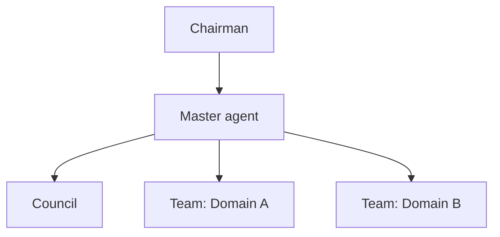

# Org chart template

Prefer `org.json` as the live source. This markdown is for quick drafting.

## Vision
One paragraph.

## Values
- …

## Map

## Seats

| Seat | Reports to | Purpose | Outcome |
|---|---|---|---|
| Master agent | Chairman | Interface | Clear reports and carried decisions |
| … | … | … | … |
